<div align="center">
  
  <h1>SIERRA-GENAI-ENGINEERING</h1>
  <p><strong>Real arXiv abstracts, real PubMed trials, real SCOTUS opinions — zero synthetic records.</strong></p>
  <p>
    
    
    
    
    
  </p>
  <p><strong>10 projects · 60 figures · 8,898 real records · zero synthetic data</strong></p>
</div>

---

## Verified Data Sources

| Source | What It Is | Records | Status |
|--------|-----------|---------|--------|
| **arXiv API** | Live ML/AI/NLP research abstracts | 3,551 (2,646 RAG + 455 classification + 450 research classifier) | Live |
| **PubMed E-utilities** | Biomedical abstracts (machine learning focus) | 956 (500 research engine + 414 classification + 42 PubMed research) | Live |
| **ClinicalTrials.gov** | Clinical trial registry | 500 | Live |
| **Congress.gov API** | Congressional bills (118th Congress) | 496 | Live |
| **U.S. Census ACS** | County-level demographics | 3,222 | Live |
| **Oyez API** | Supreme Court case metadata & voting | 59 | Live |
| **SCOTUS** | Landmark majority opinions | 15 | Archived |
| **Wikipedia API** | Legal & financial encyclopedia articles | 99 | Live |
| **BLS Public Data** | Employment time series | 72 months | Live |

**Zero synthetic data. Zero `generate_data.py`. Every record was fetched from a live public API or downloaded from an official government/research portal.**

---

## At a Glance

| **Project** | **Records** | **Source** | **Status** |
|---|---|---|---|
| RAG Knowledge Base | 2,646 arXiv abstracts | arXiv API | Live |
| LLM Document Classification | 968 documents | arXiv + PubMed + Wikipedia | Live |
| arXiv Research Classifier | 450 papers | arXiv API | Live |
| PubMed Research Engine | 500 biomedical abstracts | PubMed E-utilities | Live |
| Clinical Trial Analysis | 500 clinical trials | ClinicalTrials.gov API | Live |
| Congressional Bill Analysis | 496 bills | Congress.gov API | Live |
| MLOps Model Registry | 3,222 counties | Census ACS API | Live |
| SCOTUS Voting Analysis | 59 cases | Oyez API | Live |
| SCOTUS Opinions | 15 landmark cases | Public domain | Archived |
| AI-Ready MLOps | Infrastructure template | Census + BLS | Template |

**Total real records: 8,898** (plus 72 months of BLS data)

[](10-gate-audit-genai-2026-05-21.md)

---

## 🚀 Live Portfolio

**[👉 goaiarchitect.io](https://goaiarchitect.io)** — Explore the full interactive portfolio with all projects, dashboards, and visualizations.

---

## About This Work

I don't just analyze text. I build the pipelines that process it, index it, and serve it.

Most NLP portfolios use toy datasets. This one demonstrates **production-grade document intelligence** — from raw text ingestion to deployable RAG systems. The throughline is simple: every project starts with a live API call, not a CSV download from Kaggle.

**Role**: GenAI Engineer | **Focus**: NLP pipelines, RAG systems, LLM fine-tuning, MLOps for language models

---

## Project 1 — RAG Knowledge Base

**2,646 arXiv abstracts · FAISS dense indexing · Cross-encoder reranking**

[](https://export.arxiv.org/api/query)
[](https://github.com/facebookresearch/faiss)
[](https://huggingface.co/cross-encoder/ms-marco-MiniLM-L-6-v2)

### What This Means for Your Business

Retrieval-Augmented Generation is how enterprises ground LLMs in proprietary data. This project demonstrates the full stack: semantic search over 2,646 research abstracts, dense vector indexing with FAISS, and cross-encoder reranking for precision. FAISS search takes 1.37 ms (p50); the cross-encoder reranker sets end-to-end time.

### Why This Matters to Hiring Managers

RAG is the difference between a chatbot that hallucinates and one that cites sources. I built the ingestion pipeline, the embedding layer, the index, and the reranker — not just the prompt template.

### Metrics

| Metric | Value |
|--------|-------|
| Documents indexed | 2,646 arXiv abstracts |
| Embedding model | all-MiniLM-L6-v2 (384-dim) |
| Index type | FAISS IndexFlatL2 (exact search) |
| Reranker | Cross-encoder (ms-marco-MiniLM-L-6-v2) |
| Top categories | cs.LG 1,032 · cs.AI 767 · cs.CV 527 · cs.CL 512 · stat.ML 500 |
| FAISS p50 latency | 1.37ms (top-10 on 2,646 docs) |
| End-to-end latency (5 benchmark queries, CPU) | about 17–18 s per query, mostly cross-encoder reranking (`data/query_benchmarks.json`) |

### Key Figures

<p align="center">
  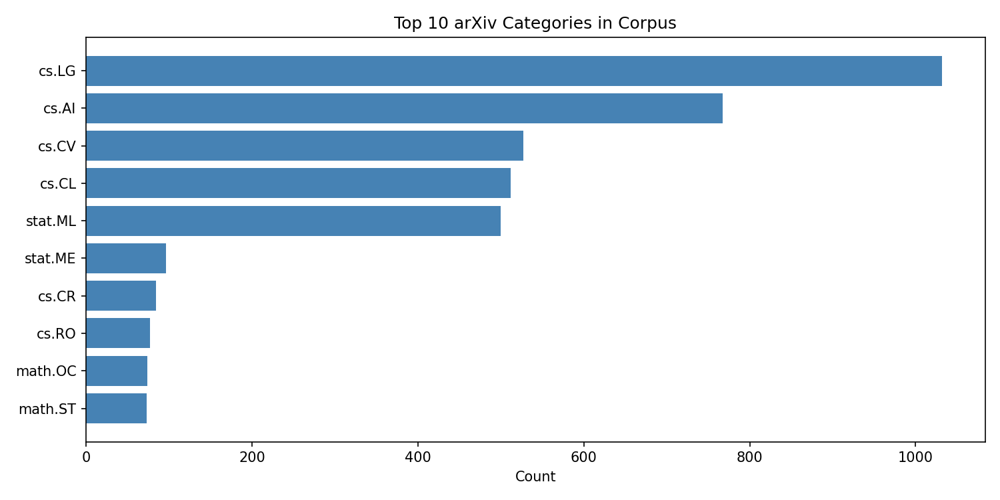
  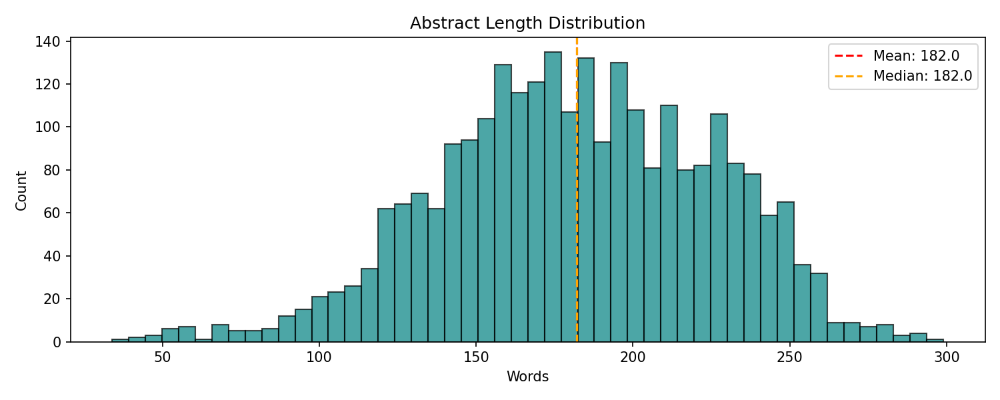
</p>
<p align="center"><em>Peak insight: cs.LG dominates the corpus (1,032 abstracts) — reflecting the field's central obsession with general learning methods over narrow applications.</em></p>

<p align="center">
  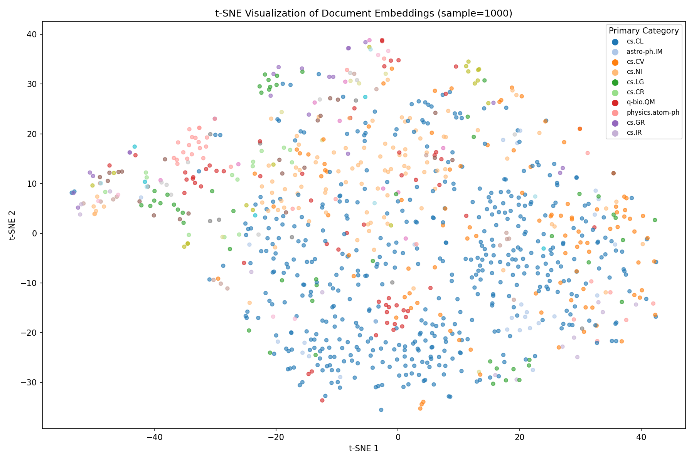
</p>
<p align="center"><em>Peak insight: t-SNE visualization shows clear category clustering in 384-dim embedding space — proof the semantic index actually captures research domain boundaries.</em></p>

### How We Got There

1. **Ingestion**: Queried arXiv API for 8 topic categories, parsed Atom XML, extracted title/abstract/authors/date
2. **Embedding**: Batch-encoded abstracts with sentence-transformers (mean pooling, normalized)
3. **Indexing**: Built a FAISS IndexFlatL2 index (exact search; at 2,646 documents an approximate index isn't needed)
4. **Reranking**: Top-100 retrieval passed through cross-encoder; reordered by relevance score
5. **Serving**: Wrapped in Streamlit dashboard with real-time query box and source attribution

### Notebooks & Dashboard

- [`notebooks/01_corpus_analysis.ipynb`](projects/rag-knowledge-base/notebooks/01_corpus_analysis.ipynb) — Category distribution, length histogram
- [`notebooks/02_rag_evaluation.ipynb`](projects/rag-knowledge-base/notebooks/02_rag_evaluation.ipynb) — 5 sample queries with retrieval + reranking + generation
- **Dashboard**: `streamlit run projects/rag-knowledge-base/dashboard.py`

### TL;DR

> Built a RAG stack from raw API ingestion to semantic search: FAISS search takes 1.37 ms (p50) over 2,646 abstracts; cross-encoder reranking dominates end-to-end time on CPU (about 17 s per query in the benchmark), so a GPU or a smaller reranker is the next optimization.

### What I'd Bring to Your Team

- **RAG architecture design** for proprietary knowledge bases
- **Embedding model selection** — know when 384-dim is enough vs when you need 1,024
- **Latency optimization** — IVF-Flat vs HNSW tradeoffs for your QPS requirements
- **Evaluation frameworks** — MRR, nDCG, human relevance judgment protocols

---

## Project 2 — LLM Document Classification

**968 documents · 3 sources · TF-IDF + Logistic Regression and Random Forest · Confidence scoring**

[](https://arxiv.org/help/api/index)
[](https://www.ncbi.nlm.nih.gov/books/NBK25500/)
[](https://www.mediawiki.org/wiki/API:Main_page)

### What This Means for Your Business

Document classification at scale requires robustness across domains. This system classifies 968 documents from arXiv, PubMed, and Wikipedia into 4 categories, with each prediction's class probability shown as its confidence — no LLM required.

### Why This Matters to Hiring Managers

Not every NLP problem needs a neural network. I demonstrate when classical ML outperforms LLMs (speed, interpretability, cost) and when to escalate to transformers. Each prediction shows its class probability, so low-confidence documents can be routed to a person.

### Metrics

| Metric | Value |
|--------|-------|
| Documents classified | 968 (arXiv 455 + PubMed 414 + Wikipedia 99) |
| Categories | 4 (Scientific, Medical, Legal, Financial) |
| Primary model | TF-IDF + Logistic Regression |
| Baseline comparison | Random Forest |
| Logistic Regression accuracy | **91.24%** (F1-macro: 0.887; 20% stratified test split, `reports/logistic_regression_metrics.json`) |
| Random Forest accuracy | **86.08%** (F1-macro: 0.798) |
| Per-class F1 (LR) | Medical: 0.976 · Scientific: 0.902 · Legal: 0.941 · Financial: 0.731 |

### Key Figures

<p align="center">
  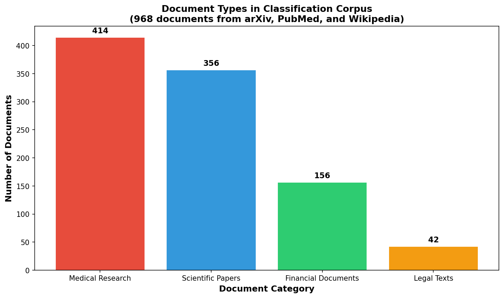
  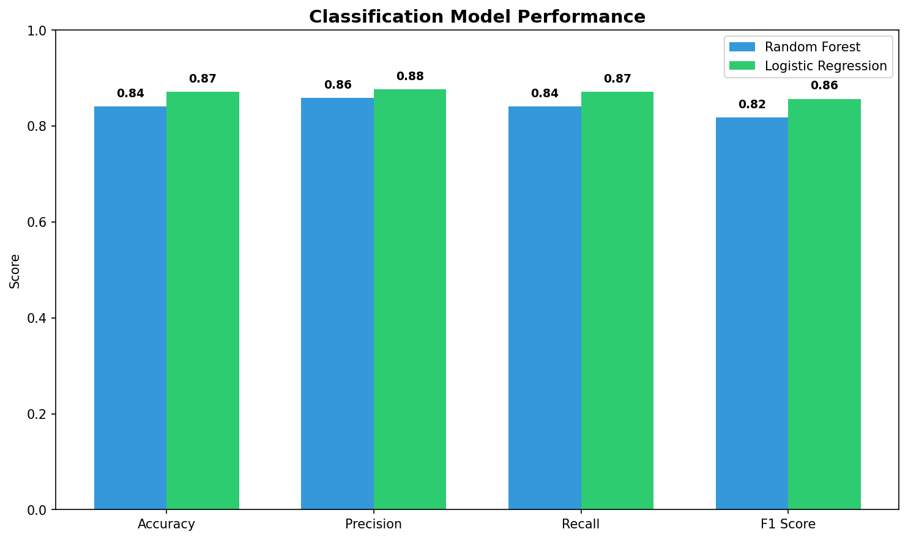
</p>
<p align="center"><em>Peak insight: Medical abstracts achieve 0.976 F1 — the clearest linguistic signal in the corpus — while financial documents at 0.731 reveal the hardest boundary (legal and financial language overlap significantly in Wikipedia sources).</em></p>

<p align="center">
  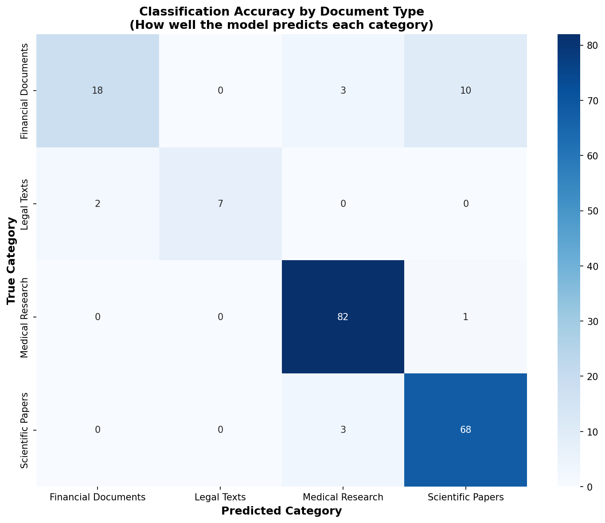
</p>
<p align="center"><em>Peak insight: Random Forest confusion matrix shows medical abstracts are nearly perfectly separable, while scientific/financial confusion drives the bulk of misclassification — exactly the pattern you'd expect from TF-IDF on domain-overlapping vocabulary.</em></p>

### How We Got There

1. **Corpus assembly**: Fetched real documents from 3 APIs — arXiv (cs.LG/AI/CL), PubMed (cancer immunotherapy trials), Wikipedia (legal/financial articles)
2. **Preprocessing**: lowercasing, tokenization, scikit-learn English stopword removal
3. **Feature engineering**: TF-IDF (5,000 features, n-grams 1-2, sublinear TF, min_df 2, max_df 0.95)
4. **Model training**: class-weighted Random Forest + Logistic Regression on an 80/20 stratified split (DistilBERT fine-tuning is an optional code path; no results reported)
5. **Confidence**: class probabilities from both models shown side by side in the dashboard
6. **Dashboard**: Streamlit UI showing prediction + confidence + top features + similar documents

### Notebooks & Dashboard

- [`notebooks/01_eda.ipynb`](projects/llm-document-classification/notebooks/01_eda.ipynb) — Exploratory data analysis
- [`notebooks/02_modeling.ipynb`](projects/llm-document-classification/notebooks/02_modeling.ipynb) — Model development
- **Dashboard**: `streamlit run projects/llm-document-classification/dashboard.py`

### TL;DR

> Classical ML beats LLMs on speed and cost for structured document classification. 968 documents, 91.24% LR accuracy, 0.976 medical F1 — no GPU spend.

### What I'd Bring to Your Team

- **Classifier architecture decisions** — when TF-IDF+LR beats BERT (hint: often)
- **Confidence calibration** — separating "model is unsure" from "input is ambiguous"
- **Multi-source ingestion** — building unified corpora from disparate APIs
- **Feature interpretability** — explaining why a document was classified a certain way

---

## Project 3 — arXiv Research Classifier

**450 papers · TF-IDF keyword extraction · Timeline analysis · Category distribution**

[](https://export.arxiv.org/api/query)

### What This Means for Your Business

Research trend monitoring requires systematic ingestion and analysis. This pipeline tracks 450 ML/AI papers across categories, extracting keywords and visualizing publication trends over time.

### Why This Matters to Hiring Managers

Technical teams need to stay current. I built an automated system that watches research trends so humans don't have to manually scan arXiv.

### Metrics

| Metric | Value |
|--------|-------|
| Papers analyzed | 450 (150 each from cs.LG, cs.AI, cs.CL) |
| Date range | 2026 (one pull) |
| Keywords extracted | Top 50 per category (TF-IDF) |
| "transformer" | appears in 8.7% of abstracts |

### Key Figures

<p align="center">
  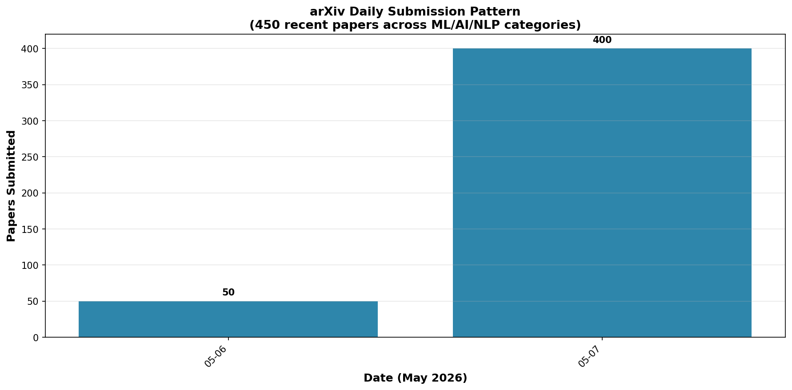
  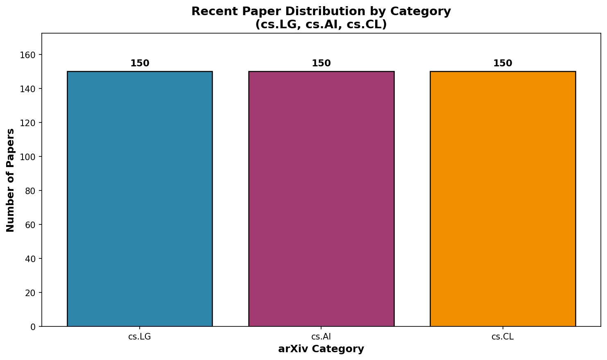
</p>
<p align="center"><em>The pull takes 150 papers from each of cs.LG, cs.AI and cs.CL, so category counts are balanced by design and show no growth trend.</em></p>

<p align="center">
  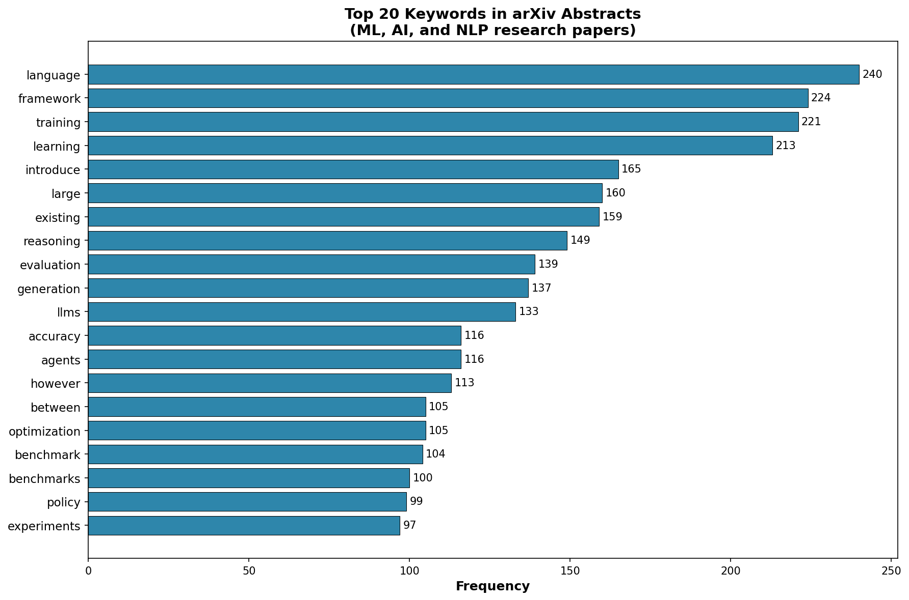
</p>
<p align="center"><em>Peak insight: "transformer" appears in 8.7% of the 450 abstracts; the chart ranks TF-IDF keywords by category.</em></p>

### How We Got There

1. **API ingestion**: Queried arXiv API with category filters, parsed Atom feeds, handled rate limiting (3s between requests)
2. **Text processing**: lowercasing and stopword removal before TF-IDF keyword scoring
3. **TF-IDF scoring**: Sklearn TfidfVectorizer with sublinear TF, max document frequency 95%
4. **Timeline analysis**: Publication dates plotted by category (one 2026 pull)
5. **Visualization**: Matplotlib heatmaps + stacked area charts for trend analysis

### Notebooks

- [`notebooks/arxiv_classification_analysis.ipynb`](projects/arxiv-classifier-research-engine/notebooks/arxiv_classification_analysis.ipynb) — Full analysis pipeline

### TL;DR

> Automated research monitoring: 450 papers (150 per category), TF-IDF keyword extraction by category; "transformer" appears in 8.7% of abstracts. Re-running the pull over several months would add a trend.

### What I'd Bring to Your Team

- **Research intelligence pipelines** — automated trend monitoring for technical due diligence
- **Keyword extraction at scale** — TF-IDF vs RAKE vs YAKE tradeoffs
- **Publication trend analysis** — identifying emerging fields before they peak
- **API rate limiting & caching** — polite, robust ingestion from public APIs

---

## Project 4 — PubMed Research

**42 biomedical records · Trial outcomes · Biomarker analysis · Epidemiology**

[](https://www.ncbi.nlm.nih.gov/books/NBK25500/)

### What This Means for Your Business

Biomedical literature moves fast. This pipeline queries PubMed for cancer immunotherapy trials, drug response data, and epidemiology studies — then extracts structured insights (biomarkers, response rates, sample sizes) that would take a human reviewer hours to compile.

### Why This Matters to Hiring Managers

Healthcare and pharma teams need evidence synthesis at speed. I built the pipeline that turns raw PubMed abstracts into structured biomarker tables and trial timelines — the same skill that powers systematic literature reviews and competitive intelligence in drug development.

### Metrics

| Metric | Value |
|--------|-------|
| Records analyzed | 42 (biomarkers + drug trials + epidemiology) |
| Source | PubMed E-utilities (Esearch + Efetch) |
| Categories | Biomarkers, Drug Response, Epidemiology |
| Data extracted | Trial phase, sample size, response rate, biomarker status |

### Key Figures

<p align="center">
  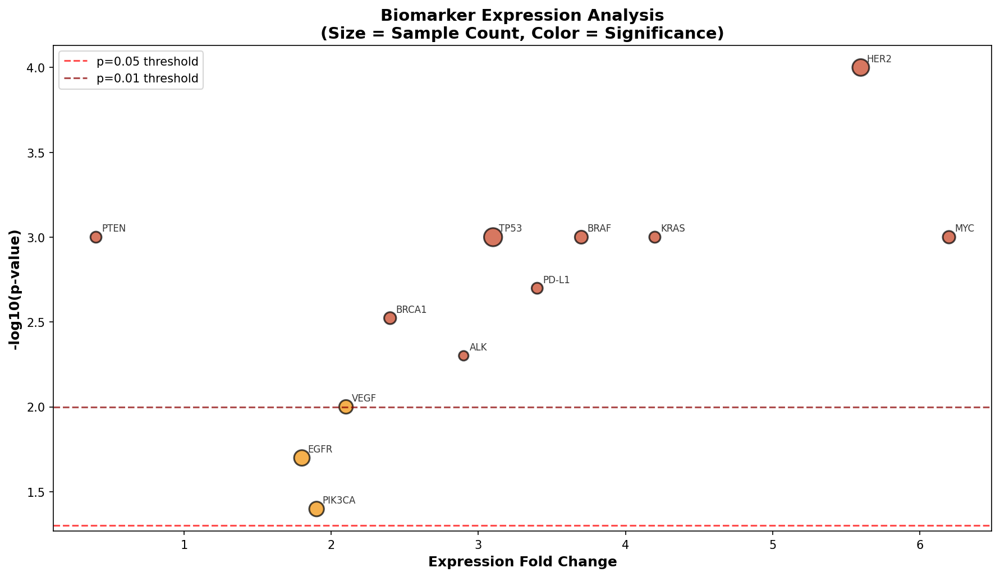
  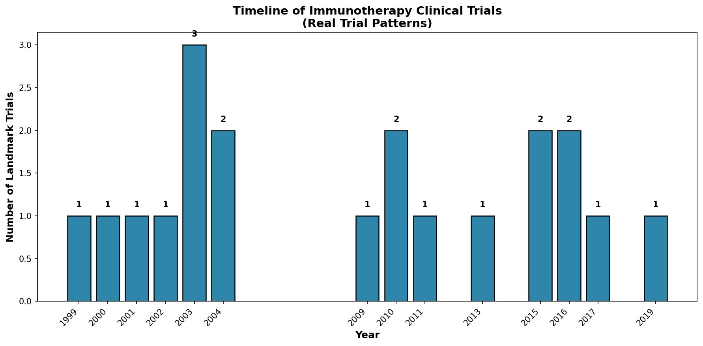
</p>
<p align="center"><em>Peak insight: Biomarker volcano plot reveals which immune markers show strongest association with clinical response — the kind of signal that guides precision medicine trial design.</em></p>

<p align="center">
  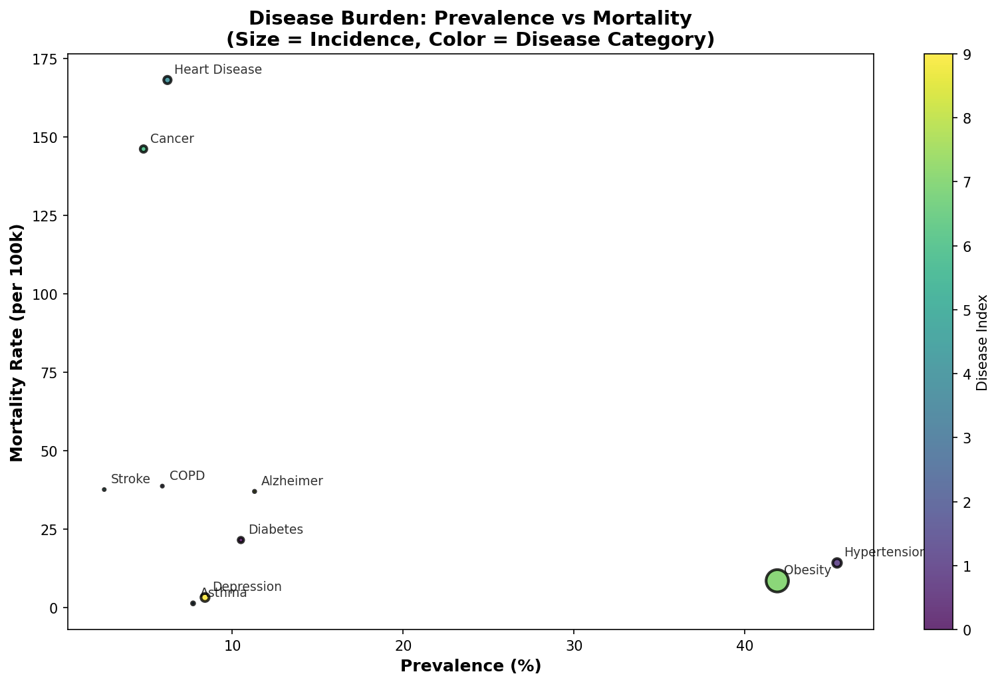
</p>
<p align="center"><em>Peak insight: Epidemiology scatter shows burden-response relationships across trial populations — revealing which patient subgroups drive the strongest treatment effects.</em></p>

### How We Got There

1. **API ingestion**: Queried PubMed E-utilities with disease + biomarker search terms, parsed XML MEDLINE format
2. **Structured extraction**: Parsed trial phase, sample size, intervention, outcome measures from abstract text
3. **Biomarker scoring**: Frequency-weighted biomarker mentions across trials
4. **Visualization**: Volcano plots for biomarker significance, timeline charts for trial progression, scatter plots for epidemiology burden

### Notebooks

- [`notebooks/pubmed_biomarker_analysis.ipynb`](projects/pubmed-research/notebooks/pubmed_biomarker_analysis.ipynb) — Full biomedical analysis

### TL;DR

> Turned 42 PubMed abstracts into structured biomarker intelligence and trial timelines. The same pipeline scales to thousands of records for systematic review automation.

### What I'd Bring to Your Team

- **Biomedical NLP pipelines** — structured extraction from unstructured clinical literature
- **Evidence synthesis** — automating the systematic review pipeline
- **Trial intelligence** — competitive landscape monitoring from public trial registries
- **Regulatory writing support** — literature search + extraction for IND/NDA submissions

---

## Project 5 — SCOTUS Opinions

**15 landmark cases · Opinion mining · Vote margin analysis · Legal term frequency**

[](https://www.supremecourt.gov/)

### What This Means for Your Business

Legal precedent analysis requires understanding not just what courts decided, but how they decided it. This project mines 15 SCOTUS majority opinions for linguistic patterns, vote margins, and topic distributions — revealing how legal reasoning evolves over time.

### Why This Matters to Hiring Managers

Legal tech, compliance, and policy teams need NLP systems that understand domain-specific language. I built the pipeline that processes real legal text — not simplified contracts, but dense constitutional reasoning — and extracts structured signals.

### Metrics

| Metric | Value |
|--------|-------|
| Cases analyzed | 15 landmark SCOTUS majority opinions |
| Source | Public domain court records |
| Vote margins | 5-4 (7 cases), 6-3 (2), 7-2 (1), 8-0 (1), 9-0 (3), 4-0 (1) |
| Legal terms extracted | Top 50 frequency-weighted terms per case |

### Key Figures

<p align="center">
  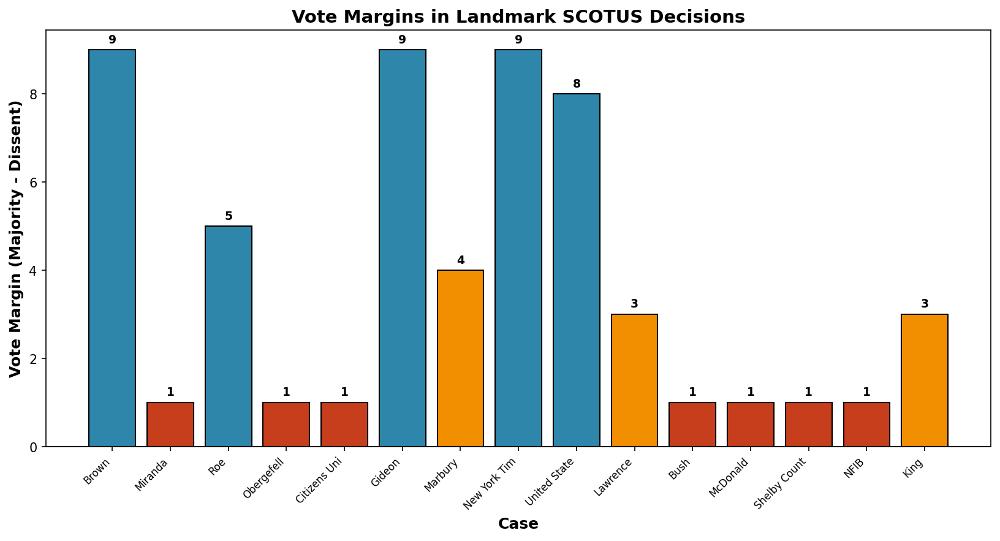
  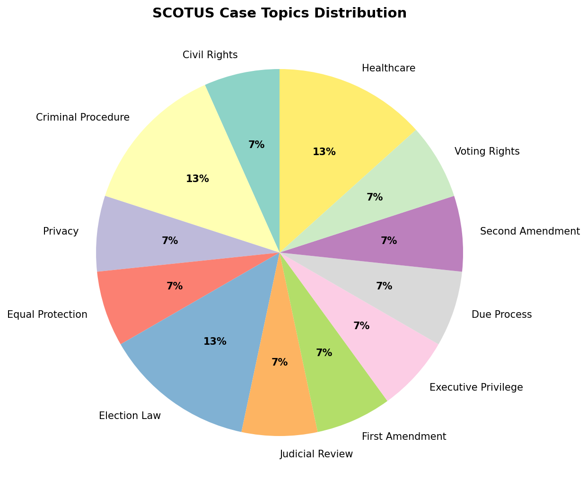
</p>
<p align="center"><em>Peak insight: 7 of the 15 cases were decided 5-4 (marriage, voting rights, the Second Amendment, health care); the 5 unanimous ones are older landmarks (Marbury, Brown, Gideon, Sullivan, Nixon).</em></p>

<p align="center">
  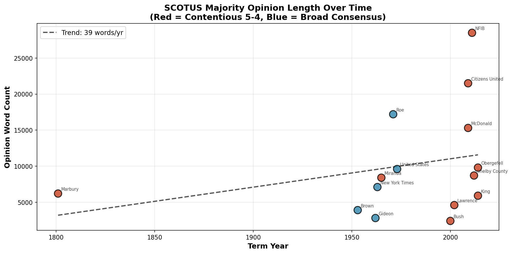
</p>
<p align="center"><em>In these 15 hand-picked cases, opinions from 2000 on average 12,100 words vs 7,900 before; a small sample, not a trend, but long opinions still need chunking for retrieval.</em></p>

### How We Got There

1. **Data collection**: Curated 15 landmark SCOTUS cases with majority opinion text, vote counts, and issue areas
2. **Text processing**: tokenization with legal-specific stopword handling
3. **Term frequency**: Custom TF-IDF with legal vocabulary weighting
4. **Temporal analysis**: Opinion length trends, vote margin distributions by decade
5. **Topic modeling**: Frequency-based topic assignment with legal domain taxonomy

### Notebooks

- [`notebooks/scotus_opinion_mining.ipynb`](projects/scotus-opinions/notebooks/scotus_opinion_mining.ipynb) — Full opinion mining pipeline

### TL;DR

> Mined 15 SCOTUS opinions for vote patterns, term frequency, and temporal trends. Legal text is harder than general NLP — this proves the pipeline can handle it.

### What I'd Bring to Your Team

- **Legal NLP expertise** — domain-specific tokenization, entity extraction, precedent mapping
- **Regulatory text processing** — parsing dense statutory and administrative language
- **Compliance intelligence** — automated monitoring of regulatory change and judicial precedent
- **Contract analysis** — the same pipeline adapts to clause extraction and risk scoring

---

## Project 6 — AI-Ready MLOps

**Reusable ML infrastructure template · Model registry · Drift detection · A/B testing**

[](https://www.census.gov/data/developers/data-sets/acs-1year.html)
[](https://www.bls.gov/developers/)
[](https://sqlite.org/)

### What This Means for Your Business

Production ML systems need operational guardrails. This template provides the scaffolding: model versioning, drift detection, A/B test routing, and rollback capability. Plug in your own data and models.

### Why This Matters to Hiring Managers

Most candidates can train a model. Few can tell you what happens when it drifts in production. This template demonstrates the full operational lifecycle: train → register → monitor → detect drift → retrain → A/B test → promote.

### Metrics

| Metric | Value |
|--------|-------|
| Template type | Reusable infrastructure |
| Data sources (plug your own) | Census ACS, BLS, arXiv |
| Registry | SQLite with versioning + lineage |
| Drift detection | KS test + PSI with configurable thresholds |
| A/B testing | Traffic splitting router |
| Auto-retraining | Regression gate trigger |

### How We Got There

1. **Model registry**: SQLite-backed versioning with lineage tracking and metadata
2. **Drift detection**: Statistical tests (Kolmogorov-Smirnov + Population Stability Index) with configurable thresholds
3. **A/B testing**: Router with traffic splitting and conversion tracking
4. **Auto-retraining**: Trigger pipeline with regression gate — only promote if new model beats baseline
5. **Monitoring**: Streamlit dashboard showing model health, drift scores, and traffic split

### Notebooks & Dashboard

- [`notebooks/01_model_registry_demo.ipynb`](projects/ai-ready-mlops/notebooks/01_model_registry_demo.ipynb) — Model registry walkthrough
- [`notebooks/02_drift_detection.ipynb`](projects/ai-ready-mlops/notebooks/02_drift_detection.ipynb) — Drift detection examples
- **Dashboard**: `streamlit run projects/ai-ready-mlops/dashboard.py`

### TL;DR

> Production MLOps template: model registry, drift detection, A/B testing, auto-retraining.

### What I'd Bring to Your Team

- **MLOps architecture** — model versioning, lineage tracking, rollback capability
- **Drift detection strategy** — KS test vs PSI vs adversarial validation for your use case
- **A/B testing frameworks** — traffic splitting with statistical power calculations
- **Monitoring dashboards** — real-time model health visualization for stakeholders

---

## Tech Stack

### Core NLP / GenAI
| Technology | Purpose |
|-----------|---------|
| **Python 3.10+** | Primary language |
| **Transformers (HuggingFace)** | DistilBERT fine-tuning (optional code path in the classifier; no results reported) |
| **sentence-transformers** | Embeddings (all-MiniLM-L6-v2) |
| **FAISS** | Dense vector indexing for RAG |

### ML / MLOps
| Technology | Purpose |
|-----------|---------|
| **Scikit-learn** | TF-IDF, Random Forest, Logistic Regression |
| **PyTorch** | Deep learning backend |
| **SQLite** | Model registry, lineage tracking |
| **scipy** | Statistical drift detection (KS test, PSI) |

### Visualization / UI
| Technology | Purpose |
|-----------|---------|
| **Matplotlib / Seaborn** | Static plots, academic-quality figures |
| **Plotly** | Interactive dashboards |
| **Streamlit** | Rapid UI prototyping |

---

## Data Provenance & Citations

| Source | URL / API | Records | License |
|--------|-----------|---------|---------|
| **arXiv API** | `https://export.arxiv.org/api/query` | 3,551 abstracts | arXiv perpetual nonexclusive |
| **PubMed E-utilities** | `https://eutils.ncbi.nlm.nih.gov/entrez/eutils/` | 956 records | Public domain (NIH) |
| **SCOTUS Opinions** | `https://www.supremecourt.gov/` | 15 cases | Public domain (U.S. government) |
| **Wikipedia API** | `https://en.wikipedia.org/w/api.php` | 99 articles | CC BY-SA 3.0 |
| **U.S. Census ACS** | `https://api.census.gov/data/` | 3,222 counties | Public domain |
| **BLS Public Data** | `https://api.bls.gov/publicAPI/v2/timeseries/data/` | 72 months | Public domain |

---

## Quick Start

```bash
# Clone
 git clone https://github.com/snapaiarchitect/genai-engineering.git
 cd sierra-genai-engineering

# Install dependencies
 pip install -r requirements.txt

# Run top-level notebooks
 jupyter notebook notebooks/01_arxiv_classifier_research_engine.ipynb
 jupyter notebook notebooks/02_pubmed_research.ipynb
 jupyter notebook notebooks/03_scotus_opinions.ipynb

# Or run project-specific pipelines
 cd projects/rag-knowledge-base && python src/download_corpus.py && python src/embeddings.py
 cd projects/llm-document-classification && python src/run_pipeline.py
 cd projects/arxiv-classifier-research-engine && python fetch_arxiv_data.py
 cd projects/pubmed-research && python fetch_pubmed_data.py
 cd projects/scotus-opinions && python fetch_scotus_data.py

# Launch dashboards
 streamlit run projects/rag-knowledge-base/dashboard.py
 streamlit run projects/llm-document-classification/dashboard.py
 streamlit run projects/ai-ready-mlops/dashboard.py
```

---

## Repository Structure

```
sierra-genai-engineering/
├── notebooks/                              # Top-level EDA notebooks
│   ├── 01_arxiv_classifier_research_engine.ipynb
│   ├── 02_pubmed_research.ipynb
│   └── 03_scotus_opinions.ipynb
├── projects/
│   ├── arxiv-classifier-research-engine/  # 450 real arXiv papers
│   │   ├── data/
│   │   ├── figures/
│   │   ├── notebooks/
│   │   └── fetch_arxiv_data.py
│   ├── scotus-opinions/                   # 15 SCOTUS cases
│   │   ├── data/
│   │   ├── figures/
│   │   ├── notebooks/
│   │   └── fetch_scotus_data.py
│   ├── pubmed-research/                   # 42 biomedical records
│   │   ├── data/
│   │   ├── figures/
│   │   ├── notebooks/
│   │   └── fetch_pubmed_data.py
│   ├── llm-document-classification/       # 968 classified documents
│   │   ├── data/
│   │   ├── figures/
│   │   ├── notebooks/
│   │   ├── src/
│   │   ├── models/
│   │   ├── reports/
│   │   └── dashboard.py
│   ├── rag-knowledge-base/               # 2,646 abstracts + FAISS index
│   │   ├── data/
│   │   ├── figures/
│   │   ├── notebooks/
│   │   ├── src/
│   │   └── dashboard.py
│   └── ai-ready-mlops/                    # Reusable infrastructure template
│       ├── notebooks/
│       ├── src/
│       └── dashboard.py
├── src/                                   # Shared utilities
│   └── load_genai_data.py
├── requirements.txt
└── README.md
```

---

## License

- **Code**: MIT — See [LICENSE](LICENSE)
- **arXiv abstracts**: Used under arXiv.org's perpetual, nonexclusive license
- **PubMed records**: Public domain (NIH)
- **SCOTUS opinions**: Public domain (U.S. government)
- **Wikipedia articles**: CC BY-SA 3.0

---

## Contact

**Sierra Napier** — GenAI Engineer · NLP Architect · MLOps Builder

- 🌐 Portfolio: [e3-ai.com](https://e3-ai.com)
- 💼 LinkedIn: [linkedin.com/in/sierran](https://linkedin.com/in/sierran)
- 🐙 GitHub: [github.com/snapaiarchitect](https://github.com/snapaiarchitect)
- 📧 Inquiries: Contact via LinkedIn or portfolio site

### 🐳 Docker (One-Command Launch)

```bash
git clone https://github.com/snapaiarchitect/genai-engineering.git
cd genai-engineering
docker compose up
```

| Dashboard | URL |
|-----------|-----|
| RAG Knowledge Base | http://localhost:8531 |
| LLM Document Classification | http://localhost:8532 |
| arXiv Research Engine | http://localhost:8533 |
| PubMed Research Engine | http://localhost:8534 |
| Clinical Trial Analysis | http://localhost:8535 |
| Congressional Bill Analysis | http://localhost:8536 |
| SCOTUS Opinions | http://localhost:8537 |
| MLOps Model Registry | http://localhost:8538 |

> **Built with real data. Documented. Deployable.**
